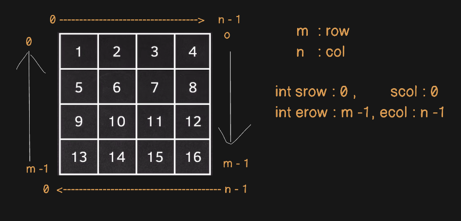
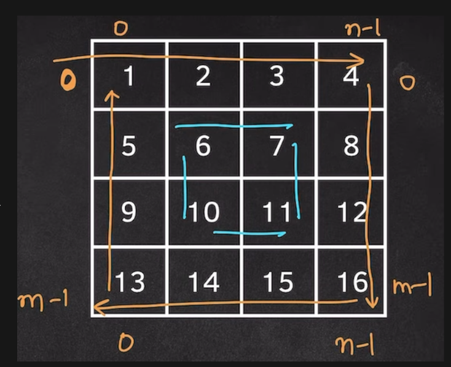
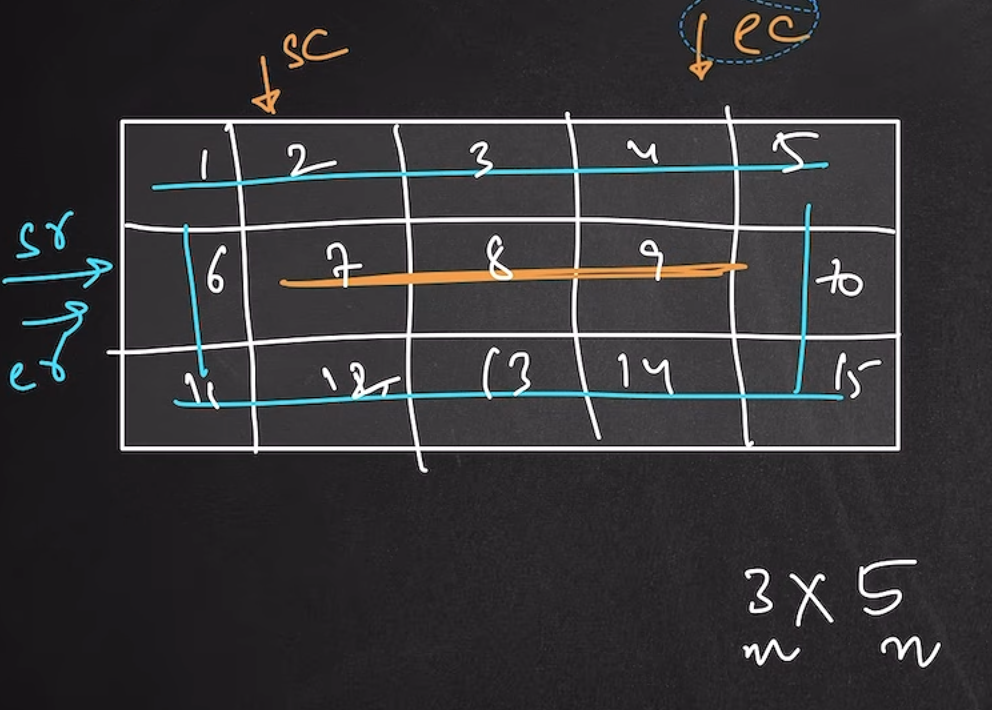

Spiral Matrix solution and breaking down the problems. 


1) We would have to divide the problem and try to scan the matrix from its boundaries.

```c++
vector<vector<int>> mat = {
        {1, 2, 3, 4},
        {5, 6, 7, 8},
        {9,10,11,12},
        {13,14,15,16}
    };
```

We know that a matrix has 4 sides.
We would need 4 loops to iterate over the boundaries. 

Lets create these variables.

int m = mat.size(), n = mat[0].size(); where m is row and n is col

int top, right, bottom, left;

We have four sides : srow, scol, erow, ecol;




Now, we would have to iterate over these boundaries to access the elements.
We would need 4 for loops for that. 

First Loop : 

Top  : 

```c++
for(int j = scol; j < ecol; j++){
        cout << mat[srow][j] < " ";
    }
```

RIght : 

```c++
for(int i = srow; i < erow; i++ ){
        cout << mat[i][ecol] << " ";
    }
```

Bottom:

```c++
for(int j = ecol - 1; i < scol; i++ ){
        cout << mat[erow][j] << " ";
    }
```

Left : 

```c++
for(int i = erow - 1; i < srow + 1){
        cout << mat[i][scol] << " ";
    }
```

Then we would have to decrease the scanning to scan over the inner matrix once we are done with outer boundaries. 

srow++  erow--;

scol ++   ecol --;



---

2) Now, we would have to


---

3) Corner Case

   

In this case, you will notice that sr and er are pointing to the same row and we will have same elements.
In this case, the top boundary and bottom boundary are same.
Since, we do not want to print this again, we would have to check if srow == erow => dont print the row. just break the loop.

Similarly, starting col and ending col are same, we woukld have check if scol == srow => dont print the col, just break the loop.


---
